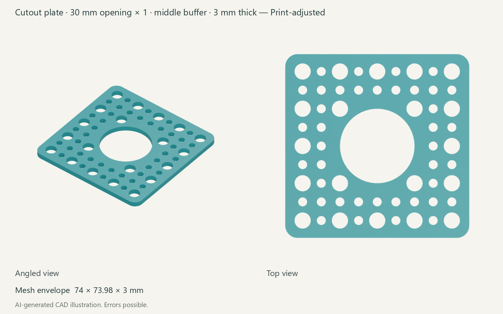

<!-- oobb-presentation:start -->
# OOBB plate cutouts

AI-generated images and instructions. Errors possible.

## Summary

3D-printable OOBB mounting plates with one to five circular openings for modular fixtures and prototypes. Choose the opening diameter, plate thickness and extra space around the cutouts; each part folder contains the printable mesh and editable OpenSCAD source.

This is an entirely AI-generated coding project. The generated outputs are included and usually work, but the main purpose of publishing it is to give others a starting point for modifying the project with their own AI tools.

Representative example: [Cutout plate · 30 mm opening × 1 · middle buffer · 3 mm thick](parts/oobb_part_plate_cutout_30_diameter_cutout_1_multiple_buffer_middle_5_width_5_height_3_depth/).

## Details

This catalogue contains **5175 records**. [Browse OOBB navigation](navigation_oobb/oobb/part/plate_cutout/).

Each part has one canonical folder, its full OOMP ID and complete metadata. Navigation links open folders; use GitHub’s file pane to browse the available files.

Nominal cutout diameters are in millimetres: 4–44 in 1 mm steps, 50–78 in 2 mm steps, and 85–145 in 5 mm steps. Plates are 3, 6 or 9 mm thick. Width and height use the 15 mm OOBB grid; the outer footprint is width × 15 − 1 by height × 15 − 1 mm. Cutouts form a centred row with 5 mm between adjacent nominal openings.

The five buffer styles are default, both, width, height and middle. The middle style adds space on both axes and rounds the plate to odd grid dimensions; a single opening sits on the central grid position. In default layouts, the retained grid holes can enlarge or join the nominal cutouts. Buffered variants keep mounting-hole centres at least 5 mm from each cutout edge. See the part metadata for the exact layout.

Run `python catalogue.py render` to refresh studio images and navigation, or `python catalogue.py build --filter <part-ID>` to rebuild one selection. Omit the filter for the full catalogue.

[Build and maintenance guide](CATALOGUE_BUILD.md)

## Parts

Choose one single-piece plate with the required cutout diameter, number of openings, buffer style and thickness. The 3dpr.stl mesh includes the generator's print allowances. Mounting fasteners and supported components depend on your application and are not included.

## Assembly

Place the plate flat in your slicer and print the selected 3dpr.stl. Check the opening and mounting-hole fit against the actual components before fastening the plate into your assembly.

[Project guide and existing assembly notes](PROJECT_GUIDE.md)
<!-- oobb-presentation:end -->
