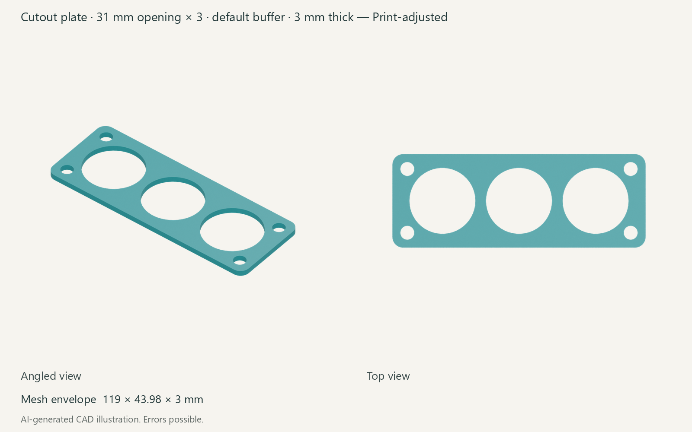

<!-- oobb-presentation:start -->
# Cutout plate · 31 mm opening × 3 · default buffer · 3 mm thick

AI-generated images and instructions. Errors possible.

## Summary

A single-piece OOBB mounting plate with 3 circular openings, each with a nominal diameter of 31 mm. The default buffer style sets the space around the openings; the plate is 3 mm thick. The retained mounting-hole pattern can enlarge or join the nominal cutouts in this default layout.

This is an entirely AI-generated coding project. The generated outputs are included and usually work, but the main purpose of publishing it is to give others a starting point for modifying the project with their own AI tools.



## Details

**Full OOMP ID:** `oobb_part_plate_cutout_31_diameter_cutout_3_multiple_buffer_default_8_width_3_height_3_depth`

[Part folder](../../../../../../../../../../parts/oobb_part_plate_cutout_31_diameter_cutout_3_multiple_buffer_default_8_width_3_height_3_depth/) · [OOBB navigation](../../../../../../../../../)

Width and height are OOBB grid units (15 mm pitch). Depth, diameter, radius and spacing are in millimetres. Use 3dpr.stl for printing.

| Field | Value |
| --- | --- |
| Nominal cutout diameter (mm) | 31 |
| Number of openings | 3 |
| Buffer style | default |
| Width (OOBB units) | 8 |
| Height (OOBB units) | 3 |
| Thickness (mm) | 3 |
| Gap between openings (mm) | 5 |
| Nominal outer footprint (mm) | 119 × 44 |

<details>
<summary>Full part details: all working.yaml fields</summary>

```yaml
bip_39_2_word_array:
- switch
- game
bip_39_2_word_no_space: switchgame
bip_39_2_word_space: switch game
bip_39_2_word_underscore: switch_game
bip_39_3_word_array:
- switch
- game
- above
bip_39_3_word_no_space: switchgameabove
bip_39_3_word_space: switch game above
bip_39_3_word_underscore: switch_game_above
bip_39_full_array:
- switch
- game
- above
- onion
- sell
- staff
- blanket
- frog
- print
- purse
- lazy
- kiwi
bip_39_full_no_space: switchgameaboveonionsellstaffblanketfrogprintpurselazykiwi
bip_39_full_space: switch game above onion sell staff blanket frog print purse lazy
  kiwi
bip_39_full_underscore: switch_game_above_onion_sell_staff_blanket_frog_print_purse_lazy_kiwi
buffer: default
clearance_height: 8
clearance_width: 11
depth: 3
diameter_cutout: 31
directory: parts/oobb_part_plate_cutout_31_diameter_cutout_3_multiple_buffer_default_8_width_3_height_3_depth
extra: 31_diameter_cutout_3_multiple_default_buffer
height: 3
id: oobb_part_plate_cutout_31_diameter_cutout_3_multiple_buffer_default_8_width_3_height_3_depth
id_no_class: oobb_part_plate_cutout_31_diameter_cutout_3_multiple_buffer_default_8_width_3_height_3_depth
id_no_size: oobb_part_plate_cutout_31_diameter_cutout_3_multiple_buffer_default_8_width_3_height_3_depth
id_no_type: oobb_part_plate_cutout_31_diameter_cutout_3_multiple_buffer_default_8_width_3_height_3_depth
link_github: https://github.com/oomlout/oomlout_oomp_version_1_messy/tree/main/parts/oobb_part_plate_cutout_31_diameter_cutout_3_multiple_buffer_default_8_width_3_height_3_depth
link_main: https://github.com/oomlout/oomlout_oomp_version_1_messy/tree/main/parts/oobb_part_plate_cutout_31_diameter_cutout_3_multiple_buffer_default_8_width_3_height_3_depth
link_redirect: https://github.com/oomlout/oomlout_oomp_version_1_messy/tree/main/parts/oobb_part_plate_cutout_31_diameter_cutout_3_multiple_buffer_default_8_width_3_height_3_depth
md5: dc2be4024d6c37a805d2e9aad5d1f9bd
md5_10: dc2be4024d
md5_10_upper: DC2BE4024D
md5_5: dc2be
md5_5_upper: DC2BE
md5_6: dc2be4
md5_6_alpha: 8l9lw
md5_6_alpha_upper: 8L9LW
md5_6_upper: DC2BE4
multiple: 3
name: Oobb Part Plate Cutout 31 Diameter Cutout 3 Multiple Buffer Default 8 Width
  3 Height 3 Depth
name_no_class: Oobb Part Plate Cutout 31 Diameter Cutout 3 Multiple Buffer Default
  8 Width 3 Height 3 Depth
name_no_size: Oobb Part Plate Cutout 31 Diameter Cutout 3 Multiple Buffer Default
  8 Width 3 Height 3 Depth
name_no_type: Oobb Part Plate Cutout 31 Diameter Cutout 3 Multiple Buffer Default
  8 Width 3 Height 3 Depth
name_proper: Oobb Part Plate Cutout 31 Diameter Cutout 3 Multiple Buffer Default 8
  Width 3 Height 3 Depth
name_space: oobb part plate cutout 31 diameter cutout 3 multiple buffer default 8
  width 3 height 3 depth
name_upper: OOBB PART PLATE CUTOUT 31 DIAMETER CUTOUT 3 MULTIPLE BUFFER DEFAULT 8
  WIDTH 3 HEIGHT 3 DEPTH
oobb_details:
  buffer: default
  clearance_height: 8
  clearance_width: 11
  depth: 3
  diameter_cutout: 31
  extra: 31_diameter_cutout_3_multiple_default_buffer
  height: 3
  multiple: 3
  oobb_name: plate_cutout
  radius_cutout: 15.5
  spacing_buffer: 3
  spacing_multiples: 5
  thickness: 3
  width: 8
oobb_name: plate_cutout
oomlout_ai_roboclick_1:
  actions:
  - command: text_jinja_template
    convert_to_pdf: false
    convert_to_png: false
    dict_data:
      buffer: default
      clearance_height: 8
      clearance_width: 11
      depth: 3
      diameter_cutout: 31
      directory: parts\oobb_part_plate_cutout_31_diameter_cutout_3_multiple_buffer_default_8_width_3_height_3_depth
      extra: 31_diameter_cutout_3_multiple_default_buffer
      height: 3
      multiple: 3
      name: oobb_part_plate_cutout_31_diameter_cutout_3_multiple_buffer_default_8_width_3_height_3_depth
      name_proper: Oobb Part Plate Cutout 31 Diameter Cutout 3 Multiple Buffer Default
        8 Width 3 Height 3 Depth
      name_space: oobb part plate cutout 31 diameter cutout 3 multiple buffer default
        8 width 3 height 3 depth
      name_upper: OOBB PART PLATE CUTOUT 31 DIAMETER CUTOUT 3 MULTIPLE BUFFER DEFAULT
        8 WIDTH 3 HEIGHT 3 DEPTH
      oobb_details:
        buffer: default
        clearance_height: 8
        clearance_width: 11
        depth: 3
        diameter_cutout: 31
        extra: 31_diameter_cutout_3_multiple_default_buffer
        height: 3
        multiple: 3
        oobb_name: plate_cutout
        radius_cutout: 15.5
        spacing_buffer: 3
        spacing_multiples: 5
        thickness: 3
        width: 8
      oobb_name: plate_cutout
      radius_cutout: 15.5
      spacing_buffer: 3
      spacing_multiples: 5
      taxonomy_1: oobb
      taxonomy_10: ''
      taxonomy_11: ''
      taxonomy_12: ''
      taxonomy_13: ''
      taxonomy_14: ''
      taxonomy_15: ''
      taxonomy_2: part
      taxonomy_3: plate_cutout
      taxonomy_4: 31_diameter_cutout
      taxonomy_5: 3_multiple
      taxonomy_6: buffer_default
      taxonomy_7: 8_width
      taxonomy_8: 3_height
      taxonomy_9: 3_depth
      url_chat: ''
      width: 8
    dict_data_files: {}
    dict_data_files_exists: {}
    file_output: label_oomp.svg
    file_template: C:\gh\oomlout_oobb_part_plate_cutout_version_5\source_file\template_jinja\template_jinja_label_oomlout_76_2_mm_50_8_mm\working.svg.j2
    search_and_replace: []
  file_test: label_oomp.pdf
  retries_until_complete: 0
oomp_key: oomp_oobb_part_plate_cutout_31_diameter_cutout_3_multiple_buffer_default_8_width_3_height_3_depth
radius_cutout: 15.5
spacing_buffer: 3
spacing_multiples: 5
taxonomy_1: oobb
taxonomy_10: ''
taxonomy_11: ''
taxonomy_12: ''
taxonomy_13: ''
taxonomy_14: ''
taxonomy_15: ''
taxonomy_1_capital: Oobb
taxonomy_1_first_letter: o
taxonomy_1_first_letter_upper: O
taxonomy_1_length_1: o
taxonomy_1_length_2: oo
taxonomy_1_length_3: oob
taxonomy_1_length_4: oobb
taxonomy_1_length_5: oobb
taxonomy_1_upper: OOBB
taxonomy_1_upper_length_1: O
taxonomy_1_upper_length_2: OO
taxonomy_1_upper_length_3: OOB
taxonomy_1_upper_length_4: OOBB
taxonomy_1_upper_length_5: OOBB
taxonomy_2: part
taxonomy_2_capital: Part
taxonomy_2_first_letter: p
taxonomy_2_first_letter_upper: P
taxonomy_2_length_1: p
taxonomy_2_length_2: pa
taxonomy_2_length_3: par
taxonomy_2_length_4: part
taxonomy_2_length_5: part
taxonomy_2_upper: PART
taxonomy_2_upper_length_1: P
taxonomy_2_upper_length_2: PA
taxonomy_2_upper_length_3: PAR
taxonomy_2_upper_length_4: PART
taxonomy_2_upper_length_5: PART
taxonomy_3: plate_cutout
taxonomy_3_capital: Plate Cutout
taxonomy_3_first_letter: p
taxonomy_3_first_letter_upper: P
taxonomy_3_length_1: p
taxonomy_3_length_2: pl
taxonomy_3_length_3: pla
taxonomy_3_length_4: plat
taxonomy_3_length_5: plate
taxonomy_3_upper: PLATE_CUTOUT
taxonomy_3_upper_length_1: P
taxonomy_3_upper_length_2: PL
taxonomy_3_upper_length_3: PLA
taxonomy_3_upper_length_4: PLAT
taxonomy_3_upper_length_5: PLATE
taxonomy_4: 31_diameter_cutout
taxonomy_4_capital: 31 Diameter Cutout
taxonomy_4_first_letter: '3'
taxonomy_4_first_letter_upper: '3'
taxonomy_4_length_1: '3'
taxonomy_4_length_2: '31'
taxonomy_4_length_3: '31_'
taxonomy_4_length_4: 31_d
taxonomy_4_length_5: 31_di
taxonomy_4_upper: 31_DIAMETER_CUTOUT
taxonomy_4_upper_length_1: '3'
taxonomy_4_upper_length_2: '31'
taxonomy_4_upper_length_3: '31_'
taxonomy_4_upper_length_4: 31_D
taxonomy_4_upper_length_5: 31_DI
taxonomy_5: 3_multiple
taxonomy_5_capital: 3 Multiple
taxonomy_5_first_letter: '3'
taxonomy_5_first_letter_upper: '3'
taxonomy_5_length_1: '3'
taxonomy_5_length_2: '3_'
taxonomy_5_length_3: 3_m
taxonomy_5_length_4: 3_mu
taxonomy_5_length_5: 3_mul
taxonomy_5_upper: 3_MULTIPLE
taxonomy_5_upper_length_1: '3'
taxonomy_5_upper_length_2: '3_'
taxonomy_5_upper_length_3: 3_M
taxonomy_5_upper_length_4: 3_MU
taxonomy_5_upper_length_5: 3_MUL
taxonomy_6: buffer_default
taxonomy_6_capital: Buffer Default
taxonomy_6_first_letter: b
taxonomy_6_first_letter_upper: B
taxonomy_6_length_1: b
taxonomy_6_length_2: bu
taxonomy_6_length_3: buf
taxonomy_6_length_4: buff
taxonomy_6_length_5: buffe
taxonomy_6_upper: BUFFER_DEFAULT
taxonomy_6_upper_length_1: B
taxonomy_6_upper_length_2: BU
taxonomy_6_upper_length_3: BUF
taxonomy_6_upper_length_4: BUFF
taxonomy_6_upper_length_5: BUFFE
taxonomy_7: 8_width
taxonomy_7_capital: 8 Width
taxonomy_7_first_letter: '8'
taxonomy_7_first_letter_upper: '8'
taxonomy_7_length_1: '8'
taxonomy_7_length_2: '8_'
taxonomy_7_length_3: 8_w
taxonomy_7_length_4: 8_wi
taxonomy_7_length_5: 8_wid
taxonomy_7_upper: 8_WIDTH
taxonomy_7_upper_length_1: '8'
taxonomy_7_upper_length_2: '8_'
taxonomy_7_upper_length_3: 8_W
taxonomy_7_upper_length_4: 8_WI
taxonomy_7_upper_length_5: 8_WID
taxonomy_8: 3_height
taxonomy_8_capital: 3 Height
taxonomy_8_first_letter: '3'
taxonomy_8_first_letter_upper: '3'
taxonomy_8_length_1: '3'
taxonomy_8_length_2: '3_'
taxonomy_8_length_3: 3_h
taxonomy_8_length_4: 3_he
taxonomy_8_length_5: 3_hei
taxonomy_8_upper: 3_HEIGHT
taxonomy_8_upper_length_1: '3'
taxonomy_8_upper_length_2: '3_'
taxonomy_8_upper_length_3: 3_H
taxonomy_8_upper_length_4: 3_HE
taxonomy_8_upper_length_5: 3_HEI
taxonomy_9: 3_depth
taxonomy_9_capital: 3 Depth
taxonomy_9_first_letter: '3'
taxonomy_9_first_letter_upper: '3'
taxonomy_9_length_1: '3'
taxonomy_9_length_2: '3_'
taxonomy_9_length_3: 3_d
taxonomy_9_length_4: 3_de
taxonomy_9_length_5: 3_dep
taxonomy_9_upper: 3_DEPTH
taxonomy_9_upper_length_1: '3'
taxonomy_9_upper_length_2: '3_'
taxonomy_9_upper_length_3: 3_D
taxonomy_9_upper_length_4: 3_DE
taxonomy_9_upper_length_5: 3_DEP
url_chat: ''
width: 8
```

</details>

## Parts

Choose one single-piece plate with the required cutout diameter, number of openings, buffer style and thickness. The 3dpr.stl mesh includes the generator's print allowances. Mounting fasteners and supported components depend on your application and are not included.

## Assembly

Place the plate flat in your slicer and print the selected 3dpr.stl. Check the opening and mounting-hole fit against the actual components before fastening the plate into your assembly.

[Project guide and existing assembly notes](../../../../../../../../../../PROJECT_GUIDE.md)
<!-- oobb-presentation:end -->
