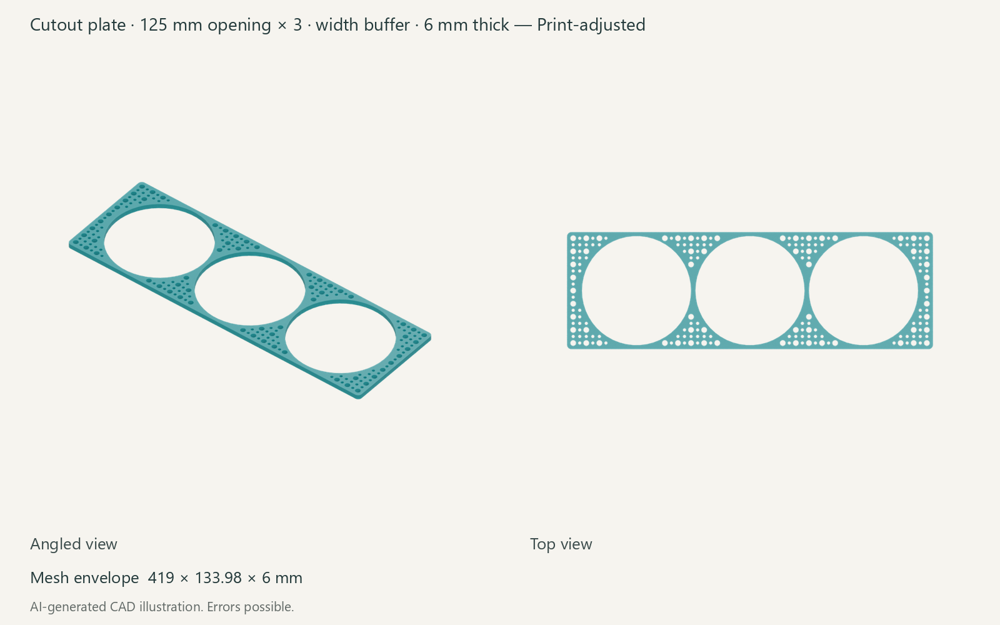

<!-- oobb-presentation:start -->
# Cutout plate · 125 mm opening × 3 · width buffer · 6 mm thick

AI-generated images and instructions. Errors possible.

## Summary

A single-piece OOBB mounting plate with 3 circular openings, each with a nominal diameter of 125 mm. The width buffer style sets the space around the openings; the plate is 6 mm thick.

This is an entirely AI-generated coding project. The generated outputs are included and usually work, but the main purpose of publishing it is to give others a starting point for modifying the project with their own AI tools.



## Details

**Full OOMP ID:** `oobb_part_plate_cutout_125_diameter_cutout_3_multiple_buffer_width_28_width_9_height_6_depth`

[Part folder](./) · [OOBB navigation](../../navigation_oobb/)

Width and height are OOBB grid units (15 mm pitch). Depth, diameter, radius and spacing are in millimetres. Use 3dpr.stl for printing.

| Field | Value |
| --- | --- |
| Nominal cutout diameter (mm) | 125 |
| Number of openings | 3 |
| Buffer style | width |
| Width (OOBB units) | 28 |
| Height (OOBB units) | 9 |
| Thickness (mm) | 6 |
| Gap between openings (mm) | 5 |
| Nominal outer footprint (mm) | 419 × 134 |

<details>
<summary>Full part details: all working.yaml fields</summary>

```yaml
bip_39_2_word_array:
- broom
- mask
bip_39_2_word_no_space: broommask
bip_39_2_word_space: broom mask
bip_39_2_word_underscore: broom_mask
bip_39_3_word_array:
- broom
- mask
- canyon
bip_39_3_word_no_space: broommaskcanyon
bip_39_3_word_space: broom mask canyon
bip_39_3_word_underscore: broom_mask_canyon
bip_39_full_array:
- broom
- mask
- canyon
- often
- world
- high
- mushroom
- shock
- payment
- glue
- invite
- napkin
bip_39_full_no_space: broommaskcanyonoftenworldhighmushroomshockpaymentglueinvitenapkin
bip_39_full_space: broom mask canyon often world high mushroom shock payment glue
  invite napkin
bip_39_full_underscore: broom_mask_canyon_often_world_high_mushroom_shock_payment_glue_invite_napkin
buffer: width
clearance_height: 4
clearance_width: 29
depth: 6
diameter_cutout: 125
directory: parts/oobb_part_plate_cutout_125_diameter_cutout_3_multiple_buffer_width_28_width_9_height_6_depth
extra: 125_diameter_cutout_3_multiple_width_buffer
height: 9
id: oobb_part_plate_cutout_125_diameter_cutout_3_multiple_buffer_width_28_width_9_height_6_depth
id_no_class: oobb_part_plate_cutout_125_diameter_cutout_3_multiple_buffer_width_28_width_9_height_6_depth
id_no_size: oobb_part_plate_cutout_125_diameter_cutout_3_multiple_buffer_width_28_width_9_height_6_depth
id_no_type: oobb_part_plate_cutout_125_diameter_cutout_3_multiple_buffer_width_28_width_9_height_6_depth
link_github: https://github.com/oomlout/oomlout_oomp_version_1_messy/tree/main/parts/oobb_part_plate_cutout_125_diameter_cutout_3_multiple_buffer_width_28_width_9_height_6_depth
link_main: https://github.com/oomlout/oomlout_oomp_version_1_messy/tree/main/parts/oobb_part_plate_cutout_125_diameter_cutout_3_multiple_buffer_width_28_width_9_height_6_depth
link_redirect: https://github.com/oomlout/oomlout_oomp_version_1_messy/tree/main/parts/oobb_part_plate_cutout_125_diameter_cutout_3_multiple_buffer_width_28_width_9_height_6_depth
md5: 1cd10c874cdfdad7247632a1ac7dd849
md5_10: 1cd10c874c
md5_10_upper: 1CD10C874C
md5_5: 1cd10
md5_5_upper: 1CD10
md5_6: 1cd10c
md5_6_alpha: 14h70
md5_6_alpha_upper: 14H70
md5_6_upper: 1CD10C
multiple: 3
name: Oobb Part Plate Cutout 125 Diameter Cutout 3 Multiple Buffer Width 28 Width
  9 Height 6 Depth
name_no_class: Oobb Part Plate Cutout 125 Diameter Cutout 3 Multiple Buffer Width
  28 Width 9 Height 6 Depth
name_no_size: Oobb Part Plate Cutout 125 Diameter Cutout 3 Multiple Buffer Width 28
  Width 9 Height 6 Depth
name_no_type: Oobb Part Plate Cutout 125 Diameter Cutout 3 Multiple Buffer Width 28
  Width 9 Height 6 Depth
name_proper: Oobb Part Plate Cutout 125 Diameter Cutout 3 Multiple Buffer Width 28
  Width 9 Height 6 Depth
name_space: oobb part plate cutout 125 diameter cutout 3 multiple buffer width 28
  width 9 height 6 depth
name_upper: OOBB PART PLATE CUTOUT 125 DIAMETER CUTOUT 3 MULTIPLE BUFFER WIDTH 28
  WIDTH 9 HEIGHT 6 DEPTH
oobb_details:
  buffer: width
  clearance_height: 4
  clearance_width: 29
  depth: 6
  diameter_cutout: 125
  extra: 125_diameter_cutout_3_multiple_width_buffer
  height: 9
  multiple: 3
  oobb_name: plate_cutout
  radius_cutout: 62.5
  spacing_buffer: 3
  spacing_multiples: 5
  thickness: 6
  width: 28
oobb_name: plate_cutout
oomlout_ai_roboclick_1:
  actions:
  - command: text_jinja_template
    convert_to_pdf: false
    convert_to_png: false
    dict_data:
      buffer: width
      clearance_height: 4
      clearance_width: 29
      depth: 6
      diameter_cutout: 125
      directory: parts\oobb_part_plate_cutout_125_diameter_cutout_3_multiple_buffer_width_28_width_9_height_6_depth
      extra: 125_diameter_cutout_3_multiple_width_buffer
      height: 9
      multiple: 3
      name: oobb_part_plate_cutout_125_diameter_cutout_3_multiple_buffer_width_28_width_9_height_6_depth
      name_proper: Oobb Part Plate Cutout 125 Diameter Cutout 3 Multiple Buffer Width
        28 Width 9 Height 6 Depth
      name_space: oobb part plate cutout 125 diameter cutout 3 multiple buffer width
        28 width 9 height 6 depth
      name_upper: OOBB PART PLATE CUTOUT 125 DIAMETER CUTOUT 3 MULTIPLE BUFFER WIDTH
        28 WIDTH 9 HEIGHT 6 DEPTH
      oobb_details:
        buffer: width
        clearance_height: 4
        clearance_width: 29
        depth: 6
        diameter_cutout: 125
        extra: 125_diameter_cutout_3_multiple_width_buffer
        height: 9
        multiple: 3
        oobb_name: plate_cutout
        radius_cutout: 62.5
        spacing_buffer: 3
        spacing_multiples: 5
        thickness: 6
        width: 28
      oobb_name: plate_cutout
      radius_cutout: 62.5
      spacing_buffer: 3
      spacing_multiples: 5
      taxonomy_1: oobb
      taxonomy_10: ''
      taxonomy_11: ''
      taxonomy_12: ''
      taxonomy_13: ''
      taxonomy_14: ''
      taxonomy_15: ''
      taxonomy_2: part
      taxonomy_3: plate_cutout
      taxonomy_4: 125_diameter_cutout
      taxonomy_5: 3_multiple
      taxonomy_6: buffer_width
      taxonomy_7: 28_width
      taxonomy_8: 9_height
      taxonomy_9: 6_depth
      url_chat: ''
      width: 28
    dict_data_files: {}
    dict_data_files_exists: {}
    file_output: label_oomp.svg
    file_template: C:\gh\oomlout_oobb_part_plate_cutout_version_5\source_file\template_jinja\template_jinja_label_oomlout_76_2_mm_50_8_mm\working.svg.j2
    search_and_replace: []
  file_test: label_oomp.pdf
  retries_until_complete: 0
oomp_key: oomp_oobb_part_plate_cutout_125_diameter_cutout_3_multiple_buffer_width_28_width_9_height_6_depth
radius_cutout: 62.5
spacing_buffer: 3
spacing_multiples: 5
taxonomy_1: oobb
taxonomy_10: ''
taxonomy_11: ''
taxonomy_12: ''
taxonomy_13: ''
taxonomy_14: ''
taxonomy_15: ''
taxonomy_1_capital: Oobb
taxonomy_1_first_letter: o
taxonomy_1_first_letter_upper: O
taxonomy_1_length_1: o
taxonomy_1_length_2: oo
taxonomy_1_length_3: oob
taxonomy_1_length_4: oobb
taxonomy_1_length_5: oobb
taxonomy_1_upper: OOBB
taxonomy_1_upper_length_1: O
taxonomy_1_upper_length_2: OO
taxonomy_1_upper_length_3: OOB
taxonomy_1_upper_length_4: OOBB
taxonomy_1_upper_length_5: OOBB
taxonomy_2: part
taxonomy_2_capital: Part
taxonomy_2_first_letter: p
taxonomy_2_first_letter_upper: P
taxonomy_2_length_1: p
taxonomy_2_length_2: pa
taxonomy_2_length_3: par
taxonomy_2_length_4: part
taxonomy_2_length_5: part
taxonomy_2_upper: PART
taxonomy_2_upper_length_1: P
taxonomy_2_upper_length_2: PA
taxonomy_2_upper_length_3: PAR
taxonomy_2_upper_length_4: PART
taxonomy_2_upper_length_5: PART
taxonomy_3: plate_cutout
taxonomy_3_capital: Plate Cutout
taxonomy_3_first_letter: p
taxonomy_3_first_letter_upper: P
taxonomy_3_length_1: p
taxonomy_3_length_2: pl
taxonomy_3_length_3: pla
taxonomy_3_length_4: plat
taxonomy_3_length_5: plate
taxonomy_3_upper: PLATE_CUTOUT
taxonomy_3_upper_length_1: P
taxonomy_3_upper_length_2: PL
taxonomy_3_upper_length_3: PLA
taxonomy_3_upper_length_4: PLAT
taxonomy_3_upper_length_5: PLATE
taxonomy_4: 125_diameter_cutout
taxonomy_4_capital: 125 Diameter Cutout
taxonomy_4_first_letter: '1'
taxonomy_4_first_letter_upper: '1'
taxonomy_4_length_1: '1'
taxonomy_4_length_2: '12'
taxonomy_4_length_3: '125'
taxonomy_4_length_4: '125_'
taxonomy_4_length_5: 125_d
taxonomy_4_upper: 125_DIAMETER_CUTOUT
taxonomy_4_upper_length_1: '1'
taxonomy_4_upper_length_2: '12'
taxonomy_4_upper_length_3: '125'
taxonomy_4_upper_length_4: '125_'
taxonomy_4_upper_length_5: 125_D
taxonomy_5: 3_multiple
taxonomy_5_capital: 3 Multiple
taxonomy_5_first_letter: '3'
taxonomy_5_first_letter_upper: '3'
taxonomy_5_length_1: '3'
taxonomy_5_length_2: '3_'
taxonomy_5_length_3: 3_m
taxonomy_5_length_4: 3_mu
taxonomy_5_length_5: 3_mul
taxonomy_5_upper: 3_MULTIPLE
taxonomy_5_upper_length_1: '3'
taxonomy_5_upper_length_2: '3_'
taxonomy_5_upper_length_3: 3_M
taxonomy_5_upper_length_4: 3_MU
taxonomy_5_upper_length_5: 3_MUL
taxonomy_6: buffer_width
taxonomy_6_capital: Buffer Width
taxonomy_6_first_letter: b
taxonomy_6_first_letter_upper: B
taxonomy_6_length_1: b
taxonomy_6_length_2: bu
taxonomy_6_length_3: buf
taxonomy_6_length_4: buff
taxonomy_6_length_5: buffe
taxonomy_6_upper: BUFFER_WIDTH
taxonomy_6_upper_length_1: B
taxonomy_6_upper_length_2: BU
taxonomy_6_upper_length_3: BUF
taxonomy_6_upper_length_4: BUFF
taxonomy_6_upper_length_5: BUFFE
taxonomy_7: 28_width
taxonomy_7_capital: 28 Width
taxonomy_7_first_letter: '2'
taxonomy_7_first_letter_upper: '2'
taxonomy_7_length_1: '2'
taxonomy_7_length_2: '28'
taxonomy_7_length_3: '28_'
taxonomy_7_length_4: 28_w
taxonomy_7_length_5: 28_wi
taxonomy_7_upper: 28_WIDTH
taxonomy_7_upper_length_1: '2'
taxonomy_7_upper_length_2: '28'
taxonomy_7_upper_length_3: '28_'
taxonomy_7_upper_length_4: 28_W
taxonomy_7_upper_length_5: 28_WI
taxonomy_8: 9_height
taxonomy_8_capital: 9 Height
taxonomy_8_first_letter: '9'
taxonomy_8_first_letter_upper: '9'
taxonomy_8_length_1: '9'
taxonomy_8_length_2: '9_'
taxonomy_8_length_3: 9_h
taxonomy_8_length_4: 9_he
taxonomy_8_length_5: 9_hei
taxonomy_8_upper: 9_HEIGHT
taxonomy_8_upper_length_1: '9'
taxonomy_8_upper_length_2: '9_'
taxonomy_8_upper_length_3: 9_H
taxonomy_8_upper_length_4: 9_HE
taxonomy_8_upper_length_5: 9_HEI
taxonomy_9: 6_depth
taxonomy_9_capital: 6 Depth
taxonomy_9_first_letter: '6'
taxonomy_9_first_letter_upper: '6'
taxonomy_9_length_1: '6'
taxonomy_9_length_2: '6_'
taxonomy_9_length_3: 6_d
taxonomy_9_length_4: 6_de
taxonomy_9_length_5: 6_dep
taxonomy_9_upper: 6_DEPTH
taxonomy_9_upper_length_1: '6'
taxonomy_9_upper_length_2: '6_'
taxonomy_9_upper_length_3: 6_D
taxonomy_9_upper_length_4: 6_DE
taxonomy_9_upper_length_5: 6_DEP
url_chat: ''
width: 28
```

</details>

## Parts

Choose one single-piece plate with the required cutout diameter, number of openings, buffer style and thickness. The 3dpr.stl mesh includes the generator's print allowances. Mounting fasteners and supported components depend on your application and are not included.

## Assembly

Place the plate flat in your slicer and print the selected 3dpr.stl. Check the opening and mounting-hole fit against the actual components before fastening the plate into your assembly.

[Project guide and existing assembly notes](../../PROJECT_GUIDE.md)
<!-- oobb-presentation:end -->
