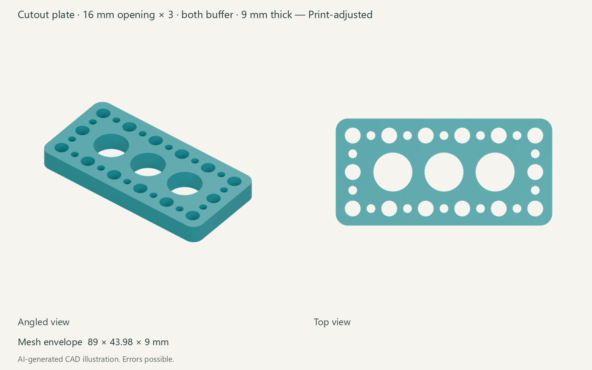

<!-- oobb-presentation:start -->
# Cutout plate · 16 mm opening × 3 · both buffer · 9 mm thick

AI-generated images and instructions. Errors possible.

## Summary

A single-piece OOBB mounting plate with 3 circular openings, each with a nominal diameter of 16 mm. The both buffer style sets the space around the openings; the plate is 9 mm thick.

This is an entirely AI-generated coding project. The generated outputs are included and usually work, but the main purpose of publishing it is to give others a starting point for modifying the project with their own AI tools.



## Details

**Full OOMP ID:** `oobb_part_plate_cutout_16_diameter_cutout_3_multiple_buffer_both_6_width_3_height_9_depth`

[Part folder](./) · [OOBB navigation](../../navigation_oobb/)

Width and height are OOBB grid units (15 mm pitch). Depth, diameter, radius and spacing are in millimetres. Use 3dpr.stl for printing.

| Field | Value |
| --- | --- |
| Nominal cutout diameter (mm) | 16 |
| Number of openings | 3 |
| Buffer style | both |
| Width (OOBB units) | 6 |
| Height (OOBB units) | 3 |
| Thickness (mm) | 9 |
| Gap between openings (mm) | 5 |
| Nominal outer footprint (mm) | 89 × 44 |

<details>
<summary>Full part details: all working.yaml fields</summary>

```yaml
bip_39_2_word_array:
- square
- gorilla
bip_39_2_word_no_space: squaregorilla
bip_39_2_word_space: square gorilla
bip_39_2_word_underscore: square_gorilla
bip_39_3_word_array:
- square
- gorilla
- awake
bip_39_3_word_no_space: squaregorillaawake
bip_39_3_word_space: square gorilla awake
bip_39_3_word_underscore: square_gorilla_awake
bip_39_full_array:
- square
- gorilla
- awake
- rifle
- cradle
- view
- expose
- produce
- mention
- stage
- lawn
- toe
bip_39_full_no_space: squaregorillaawakeriflecradleviewexposeproducementionstagelawntoe
bip_39_full_space: square gorilla awake rifle cradle view expose produce mention stage
  lawn toe
bip_39_full_underscore: square_gorilla_awake_rifle_cradle_view_expose_produce_mention_stage_lawn_toe
buffer: both
clearance_height: 23
clearance_width: 26
depth: 9
diameter_cutout: 16
directory: parts/oobb_part_plate_cutout_16_diameter_cutout_3_multiple_buffer_both_6_width_3_height_9_depth
extra: 16_diameter_cutout_3_multiple_both_buffer
height: 3
id: oobb_part_plate_cutout_16_diameter_cutout_3_multiple_buffer_both_6_width_3_height_9_depth
id_no_class: oobb_part_plate_cutout_16_diameter_cutout_3_multiple_buffer_both_6_width_3_height_9_depth
id_no_size: oobb_part_plate_cutout_16_diameter_cutout_3_multiple_buffer_both_6_width_3_height_9_depth
id_no_type: oobb_part_plate_cutout_16_diameter_cutout_3_multiple_buffer_both_6_width_3_height_9_depth
link_github: https://github.com/oomlout/oomlout_oomp_version_1_messy/tree/main/parts/oobb_part_plate_cutout_16_diameter_cutout_3_multiple_buffer_both_6_width_3_height_9_depth
link_main: https://github.com/oomlout/oomlout_oomp_version_1_messy/tree/main/parts/oobb_part_plate_cutout_16_diameter_cutout_3_multiple_buffer_both_6_width_3_height_9_depth
link_redirect: https://github.com/oomlout/oomlout_oomp_version_1_messy/tree/main/parts/oobb_part_plate_cutout_16_diameter_cutout_3_multiple_buffer_both_6_width_3_height_9_depth
md5: d36c9440dcd31fe7d42d5d8b1a85f871
md5_10: d36c9440dc
md5_10_upper: D36C9440DC
md5_5: d36c9
md5_5_upper: D36C9
md5_6: d36c94
md5_6_alpha: 88z9w
md5_6_alpha_upper: 88Z9W
md5_6_upper: D36C94
multiple: 3
name: Oobb Part Plate Cutout 16 Diameter Cutout 3 Multiple Buffer Both 6 Width 3 Height
  9 Depth
name_no_class: Oobb Part Plate Cutout 16 Diameter Cutout 3 Multiple Buffer Both 6
  Width 3 Height 9 Depth
name_no_size: Oobb Part Plate Cutout 16 Diameter Cutout 3 Multiple Buffer Both 6 Width
  3 Height 9 Depth
name_no_type: Oobb Part Plate Cutout 16 Diameter Cutout 3 Multiple Buffer Both 6 Width
  3 Height 9 Depth
name_proper: Oobb Part Plate Cutout 16 Diameter Cutout 3 Multiple Buffer Both 6 Width
  3 Height 9 Depth
name_space: oobb part plate cutout 16 diameter cutout 3 multiple buffer both 6 width
  3 height 9 depth
name_upper: OOBB PART PLATE CUTOUT 16 DIAMETER CUTOUT 3 MULTIPLE BUFFER BOTH 6 WIDTH
  3 HEIGHT 9 DEPTH
oobb_details:
  buffer: both
  clearance_height: 23
  clearance_width: 26
  depth: 9
  diameter_cutout: 16
  extra: 16_diameter_cutout_3_multiple_both_buffer
  height: 3
  multiple: 3
  oobb_name: plate_cutout
  radius_cutout: 8.0
  spacing_buffer: 3
  spacing_multiples: 5
  thickness: 9
  width: 6
oobb_name: plate_cutout
oomlout_ai_roboclick_1:
  actions:
  - command: text_jinja_template
    convert_to_pdf: false
    convert_to_png: false
    dict_data:
      buffer: both
      clearance_height: 23
      clearance_width: 26
      depth: 9
      diameter_cutout: 16
      directory: parts\oobb_part_plate_cutout_16_diameter_cutout_3_multiple_buffer_both_6_width_3_height_9_depth
      extra: 16_diameter_cutout_3_multiple_both_buffer
      height: 3
      multiple: 3
      name: oobb_part_plate_cutout_16_diameter_cutout_3_multiple_buffer_both_6_width_3_height_9_depth
      name_proper: Oobb Part Plate Cutout 16 Diameter Cutout 3 Multiple Buffer Both
        6 Width 3 Height 9 Depth
      name_space: oobb part plate cutout 16 diameter cutout 3 multiple buffer both
        6 width 3 height 9 depth
      name_upper: OOBB PART PLATE CUTOUT 16 DIAMETER CUTOUT 3 MULTIPLE BUFFER BOTH
        6 WIDTH 3 HEIGHT 9 DEPTH
      oobb_details:
        buffer: both
        clearance_height: 23
        clearance_width: 26
        depth: 9
        diameter_cutout: 16
        extra: 16_diameter_cutout_3_multiple_both_buffer
        height: 3
        multiple: 3
        oobb_name: plate_cutout
        radius_cutout: 8.0
        spacing_buffer: 3
        spacing_multiples: 5
        thickness: 9
        width: 6
      oobb_name: plate_cutout
      radius_cutout: 8.0
      spacing_buffer: 3
      spacing_multiples: 5
      taxonomy_1: oobb
      taxonomy_10: ''
      taxonomy_11: ''
      taxonomy_12: ''
      taxonomy_13: ''
      taxonomy_14: ''
      taxonomy_15: ''
      taxonomy_2: part
      taxonomy_3: plate_cutout
      taxonomy_4: 16_diameter_cutout
      taxonomy_5: 3_multiple
      taxonomy_6: buffer_both
      taxonomy_7: 6_width
      taxonomy_8: 3_height
      taxonomy_9: 9_depth
      url_chat: ''
      width: 6
    dict_data_files: {}
    dict_data_files_exists: {}
    file_output: label_oomp.svg
    file_template: C:\gh\oomlout_oobb_part_plate_cutout_version_5\source_file\template_jinja\template_jinja_label_oomlout_76_2_mm_50_8_mm\working.svg.j2
    search_and_replace: []
  file_test: label_oomp.pdf
  retries_until_complete: 0
oomp_key: oomp_oobb_part_plate_cutout_16_diameter_cutout_3_multiple_buffer_both_6_width_3_height_9_depth
radius_cutout: 8.0
spacing_buffer: 3
spacing_multiples: 5
taxonomy_1: oobb
taxonomy_10: ''
taxonomy_11: ''
taxonomy_12: ''
taxonomy_13: ''
taxonomy_14: ''
taxonomy_15: ''
taxonomy_1_capital: Oobb
taxonomy_1_first_letter: o
taxonomy_1_first_letter_upper: O
taxonomy_1_length_1: o
taxonomy_1_length_2: oo
taxonomy_1_length_3: oob
taxonomy_1_length_4: oobb
taxonomy_1_length_5: oobb
taxonomy_1_upper: OOBB
taxonomy_1_upper_length_1: O
taxonomy_1_upper_length_2: OO
taxonomy_1_upper_length_3: OOB
taxonomy_1_upper_length_4: OOBB
taxonomy_1_upper_length_5: OOBB
taxonomy_2: part
taxonomy_2_capital: Part
taxonomy_2_first_letter: p
taxonomy_2_first_letter_upper: P
taxonomy_2_length_1: p
taxonomy_2_length_2: pa
taxonomy_2_length_3: par
taxonomy_2_length_4: part
taxonomy_2_length_5: part
taxonomy_2_upper: PART
taxonomy_2_upper_length_1: P
taxonomy_2_upper_length_2: PA
taxonomy_2_upper_length_3: PAR
taxonomy_2_upper_length_4: PART
taxonomy_2_upper_length_5: PART
taxonomy_3: plate_cutout
taxonomy_3_capital: Plate Cutout
taxonomy_3_first_letter: p
taxonomy_3_first_letter_upper: P
taxonomy_3_length_1: p
taxonomy_3_length_2: pl
taxonomy_3_length_3: pla
taxonomy_3_length_4: plat
taxonomy_3_length_5: plate
taxonomy_3_upper: PLATE_CUTOUT
taxonomy_3_upper_length_1: P
taxonomy_3_upper_length_2: PL
taxonomy_3_upper_length_3: PLA
taxonomy_3_upper_length_4: PLAT
taxonomy_3_upper_length_5: PLATE
taxonomy_4: 16_diameter_cutout
taxonomy_4_capital: 16 Diameter Cutout
taxonomy_4_first_letter: '1'
taxonomy_4_first_letter_upper: '1'
taxonomy_4_length_1: '1'
taxonomy_4_length_2: '16'
taxonomy_4_length_3: '16_'
taxonomy_4_length_4: 16_d
taxonomy_4_length_5: 16_di
taxonomy_4_upper: 16_DIAMETER_CUTOUT
taxonomy_4_upper_length_1: '1'
taxonomy_4_upper_length_2: '16'
taxonomy_4_upper_length_3: '16_'
taxonomy_4_upper_length_4: 16_D
taxonomy_4_upper_length_5: 16_DI
taxonomy_5: 3_multiple
taxonomy_5_capital: 3 Multiple
taxonomy_5_first_letter: '3'
taxonomy_5_first_letter_upper: '3'
taxonomy_5_length_1: '3'
taxonomy_5_length_2: '3_'
taxonomy_5_length_3: 3_m
taxonomy_5_length_4: 3_mu
taxonomy_5_length_5: 3_mul
taxonomy_5_upper: 3_MULTIPLE
taxonomy_5_upper_length_1: '3'
taxonomy_5_upper_length_2: '3_'
taxonomy_5_upper_length_3: 3_M
taxonomy_5_upper_length_4: 3_MU
taxonomy_5_upper_length_5: 3_MUL
taxonomy_6: buffer_both
taxonomy_6_capital: Buffer Both
taxonomy_6_first_letter: b
taxonomy_6_first_letter_upper: B
taxonomy_6_length_1: b
taxonomy_6_length_2: bu
taxonomy_6_length_3: buf
taxonomy_6_length_4: buff
taxonomy_6_length_5: buffe
taxonomy_6_upper: BUFFER_BOTH
taxonomy_6_upper_length_1: B
taxonomy_6_upper_length_2: BU
taxonomy_6_upper_length_3: BUF
taxonomy_6_upper_length_4: BUFF
taxonomy_6_upper_length_5: BUFFE
taxonomy_7: 6_width
taxonomy_7_capital: 6 Width
taxonomy_7_first_letter: '6'
taxonomy_7_first_letter_upper: '6'
taxonomy_7_length_1: '6'
taxonomy_7_length_2: '6_'
taxonomy_7_length_3: 6_w
taxonomy_7_length_4: 6_wi
taxonomy_7_length_5: 6_wid
taxonomy_7_upper: 6_WIDTH
taxonomy_7_upper_length_1: '6'
taxonomy_7_upper_length_2: '6_'
taxonomy_7_upper_length_3: 6_W
taxonomy_7_upper_length_4: 6_WI
taxonomy_7_upper_length_5: 6_WID
taxonomy_8: 3_height
taxonomy_8_capital: 3 Height
taxonomy_8_first_letter: '3'
taxonomy_8_first_letter_upper: '3'
taxonomy_8_length_1: '3'
taxonomy_8_length_2: '3_'
taxonomy_8_length_3: 3_h
taxonomy_8_length_4: 3_he
taxonomy_8_length_5: 3_hei
taxonomy_8_upper: 3_HEIGHT
taxonomy_8_upper_length_1: '3'
taxonomy_8_upper_length_2: '3_'
taxonomy_8_upper_length_3: 3_H
taxonomy_8_upper_length_4: 3_HE
taxonomy_8_upper_length_5: 3_HEI
taxonomy_9: 9_depth
taxonomy_9_capital: 9 Depth
taxonomy_9_first_letter: '9'
taxonomy_9_first_letter_upper: '9'
taxonomy_9_length_1: '9'
taxonomy_9_length_2: '9_'
taxonomy_9_length_3: 9_d
taxonomy_9_length_4: 9_de
taxonomy_9_length_5: 9_dep
taxonomy_9_upper: 9_DEPTH
taxonomy_9_upper_length_1: '9'
taxonomy_9_upper_length_2: '9_'
taxonomy_9_upper_length_3: 9_D
taxonomy_9_upper_length_4: 9_DE
taxonomy_9_upper_length_5: 9_DEP
url_chat: ''
width: 6
```

</details>

## Parts

Choose one single-piece plate with the required cutout diameter, number of openings, buffer style and thickness. The 3dpr.stl mesh includes the generator's print allowances. Mounting fasteners and supported components depend on your application and are not included.

## Assembly

Place the plate flat in your slicer and print the selected 3dpr.stl. Check the opening and mounting-hole fit against the actual components before fastening the plate into your assembly.

[Project guide and existing assembly notes](../../PROJECT_GUIDE.md)
<!-- oobb-presentation:end -->
