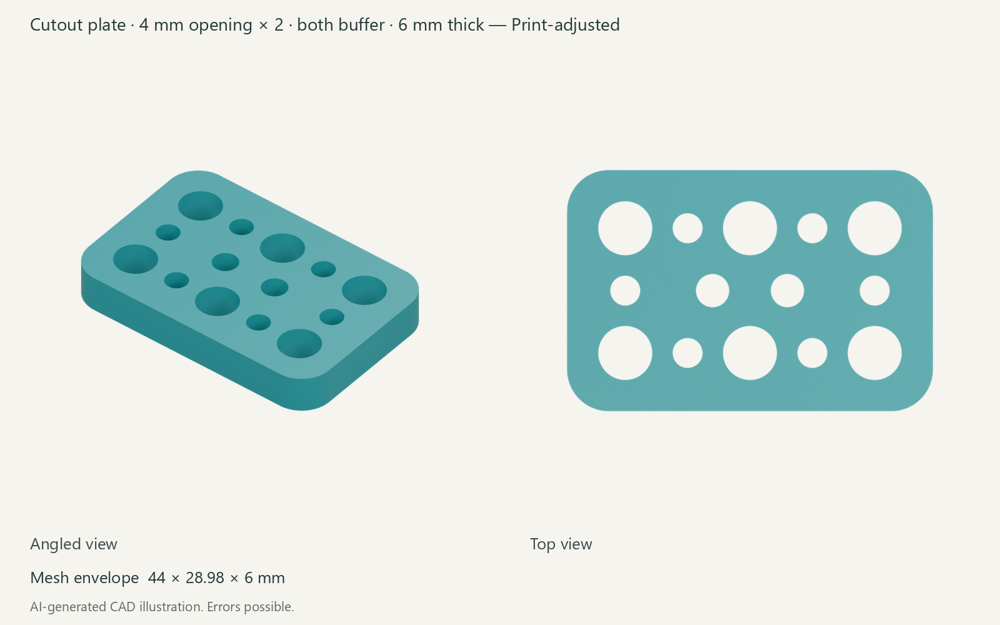

<!-- oobb-presentation:start -->
# Cutout plate · 4 mm opening × 2 · both buffer · 6 mm thick

AI-generated images and instructions. Errors possible.

## Summary

A single-piece OOBB mounting plate with 2 circular openings, each with a nominal diameter of 4 mm. The both buffer style sets the space around the openings; the plate is 6 mm thick.

This is an entirely AI-generated coding project. The generated outputs are included and usually work, but the main purpose of publishing it is to give others a starting point for modifying the project with their own AI tools.



## Details

**Full OOMP ID:** `oobb_part_plate_cutout_4_diameter_cutout_2_multiple_buffer_both_3_width_2_height_6_depth`

[Part folder](./) · [OOBB navigation](../../navigation_oobb/)

Width and height are OOBB grid units (15 mm pitch). Depth, diameter, radius and spacing are in millimetres. Use 3dpr.stl for printing.

| Field | Value |
| --- | --- |
| Nominal cutout diameter (mm) | 4 |
| Number of openings | 2 |
| Buffer style | both |
| Width (OOBB units) | 3 |
| Height (OOBB units) | 2 |
| Thickness (mm) | 6 |
| Gap between openings (mm) | 5 |
| Nominal outer footprint (mm) | 44 × 29 |

<details>
<summary>Full part details: all working.yaml fields</summary>

```yaml
bip_39_2_word_array:
- equal
- battle
bip_39_2_word_no_space: equalbattle
bip_39_2_word_space: equal battle
bip_39_2_word_underscore: equal_battle
bip_39_3_word_array:
- equal
- battle
- hybrid
bip_39_3_word_no_space: equalbattlehybrid
bip_39_3_word_space: equal battle hybrid
bip_39_3_word_underscore: equal_battle_hybrid
bip_39_full_array:
- equal
- battle
- hybrid
- shadow
- opinion
- talent
- proof
- section
- glove
- tragic
- vicious
- secret
bip_39_full_no_space: equalbattlehybridshadowopiniontalentproofsectionglovetragicvicioussecret
bip_39_full_space: equal battle hybrid shadow opinion talent proof section glove tragic
  vicious secret
bip_39_full_underscore: equal_battle_hybrid_shadow_opinion_talent_proof_section_glove_tragic_vicious_secret
buffer: both
clearance_height: 20
clearance_width: 26
depth: 6
diameter_cutout: 4
directory: parts/oobb_part_plate_cutout_4_diameter_cutout_2_multiple_buffer_both_3_width_2_height_6_depth
extra: 4_diameter_cutout_2_multiple_both_buffer
height: 2
id: oobb_part_plate_cutout_4_diameter_cutout_2_multiple_buffer_both_3_width_2_height_6_depth
id_no_class: oobb_part_plate_cutout_4_diameter_cutout_2_multiple_buffer_both_3_width_2_height_6_depth
id_no_size: oobb_part_plate_cutout_4_diameter_cutout_2_multiple_buffer_both_3_width_2_height_6_depth
id_no_type: oobb_part_plate_cutout_4_diameter_cutout_2_multiple_buffer_both_3_width_2_height_6_depth
link_github: https://github.com/oomlout/oomlout_oomp_version_1_messy/tree/main/parts/oobb_part_plate_cutout_4_diameter_cutout_2_multiple_buffer_both_3_width_2_height_6_depth
link_main: https://github.com/oomlout/oomlout_oomp_version_1_messy/tree/main/parts/oobb_part_plate_cutout_4_diameter_cutout_2_multiple_buffer_both_3_width_2_height_6_depth
link_redirect: https://github.com/oomlout/oomlout_oomp_version_1_messy/tree/main/parts/oobb_part_plate_cutout_4_diameter_cutout_2_multiple_buffer_both_3_width_2_height_6_depth
md5: 4c0269c06269b7baeb161563bcdfce61
md5_10: 4c0269c062
md5_10_upper: 4C0269C062
md5_5: 4c026
md5_5_upper: 4C026
md5_6: 4c0269
md5_6_alpha: 2yrmx
md5_6_alpha_upper: 2YRMX
md5_6_upper: 4C0269
multiple: 2
name: Oobb Part Plate Cutout 4 Diameter Cutout 2 Multiple Buffer Both 3 Width 2 Height
  6 Depth
name_no_class: Oobb Part Plate Cutout 4 Diameter Cutout 2 Multiple Buffer Both 3 Width
  2 Height 6 Depth
name_no_size: Oobb Part Plate Cutout 4 Diameter Cutout 2 Multiple Buffer Both 3 Width
  2 Height 6 Depth
name_no_type: Oobb Part Plate Cutout 4 Diameter Cutout 2 Multiple Buffer Both 3 Width
  2 Height 6 Depth
name_proper: Oobb Part Plate Cutout 4 Diameter Cutout 2 Multiple Buffer Both 3 Width
  2 Height 6 Depth
name_space: oobb part plate cutout 4 diameter cutout 2 multiple buffer both 3 width
  2 height 6 depth
name_upper: OOBB PART PLATE CUTOUT 4 DIAMETER CUTOUT 2 MULTIPLE BUFFER BOTH 3 WIDTH
  2 HEIGHT 6 DEPTH
oobb_details:
  buffer: both
  clearance_height: 20
  clearance_width: 26
  depth: 6
  diameter_cutout: 4
  extra: 4_diameter_cutout_2_multiple_both_buffer
  height: 2
  multiple: 2
  oobb_name: plate_cutout
  radius_cutout: 2.0
  spacing_buffer: 3
  spacing_multiples: 5
  thickness: 6
  width: 3
oobb_name: plate_cutout
oomlout_ai_roboclick_1:
  actions:
  - command: text_jinja_template
    convert_to_pdf: false
    convert_to_png: false
    dict_data:
      buffer: both
      clearance_height: 20
      clearance_width: 26
      depth: 6
      diameter_cutout: 4
      directory: parts\oobb_part_plate_cutout_4_diameter_cutout_2_multiple_buffer_both_3_width_2_height_6_depth
      extra: 4_diameter_cutout_2_multiple_both_buffer
      height: 2
      multiple: 2
      name: oobb_part_plate_cutout_4_diameter_cutout_2_multiple_buffer_both_3_width_2_height_6_depth
      name_proper: Oobb Part Plate Cutout 4 Diameter Cutout 2 Multiple Buffer Both
        3 Width 2 Height 6 Depth
      name_space: oobb part plate cutout 4 diameter cutout 2 multiple buffer both
        3 width 2 height 6 depth
      name_upper: OOBB PART PLATE CUTOUT 4 DIAMETER CUTOUT 2 MULTIPLE BUFFER BOTH
        3 WIDTH 2 HEIGHT 6 DEPTH
      oobb_details:
        buffer: both
        clearance_height: 20
        clearance_width: 26
        depth: 6
        diameter_cutout: 4
        extra: 4_diameter_cutout_2_multiple_both_buffer
        height: 2
        multiple: 2
        oobb_name: plate_cutout
        radius_cutout: 2.0
        spacing_buffer: 3
        spacing_multiples: 5
        thickness: 6
        width: 3
      oobb_name: plate_cutout
      radius_cutout: 2.0
      spacing_buffer: 3
      spacing_multiples: 5
      taxonomy_1: oobb
      taxonomy_10: ''
      taxonomy_11: ''
      taxonomy_12: ''
      taxonomy_13: ''
      taxonomy_14: ''
      taxonomy_15: ''
      taxonomy_2: part
      taxonomy_3: plate_cutout
      taxonomy_4: 4_diameter_cutout
      taxonomy_5: 2_multiple
      taxonomy_6: buffer_both
      taxonomy_7: 3_width
      taxonomy_8: 2_height
      taxonomy_9: 6_depth
      url_chat: ''
      width: 3
    dict_data_files: {}
    dict_data_files_exists: {}
    file_output: label_oomp.svg
    file_template: C:\gh\oomlout_oobb_part_plate_cutout_version_5\source_file\template_jinja\template_jinja_label_oomlout_76_2_mm_50_8_mm\working.svg.j2
    search_and_replace: []
  file_test: label_oomp.pdf
  retries_until_complete: 0
oomp_key: oomp_oobb_part_plate_cutout_4_diameter_cutout_2_multiple_buffer_both_3_width_2_height_6_depth
radius_cutout: 2.0
spacing_buffer: 3
spacing_multiples: 5
taxonomy_1: oobb
taxonomy_10: ''
taxonomy_11: ''
taxonomy_12: ''
taxonomy_13: ''
taxonomy_14: ''
taxonomy_15: ''
taxonomy_1_capital: Oobb
taxonomy_1_first_letter: o
taxonomy_1_first_letter_upper: O
taxonomy_1_length_1: o
taxonomy_1_length_2: oo
taxonomy_1_length_3: oob
taxonomy_1_length_4: oobb
taxonomy_1_length_5: oobb
taxonomy_1_upper: OOBB
taxonomy_1_upper_length_1: O
taxonomy_1_upper_length_2: OO
taxonomy_1_upper_length_3: OOB
taxonomy_1_upper_length_4: OOBB
taxonomy_1_upper_length_5: OOBB
taxonomy_2: part
taxonomy_2_capital: Part
taxonomy_2_first_letter: p
taxonomy_2_first_letter_upper: P
taxonomy_2_length_1: p
taxonomy_2_length_2: pa
taxonomy_2_length_3: par
taxonomy_2_length_4: part
taxonomy_2_length_5: part
taxonomy_2_upper: PART
taxonomy_2_upper_length_1: P
taxonomy_2_upper_length_2: PA
taxonomy_2_upper_length_3: PAR
taxonomy_2_upper_length_4: PART
taxonomy_2_upper_length_5: PART
taxonomy_3: plate_cutout
taxonomy_3_capital: Plate Cutout
taxonomy_3_first_letter: p
taxonomy_3_first_letter_upper: P
taxonomy_3_length_1: p
taxonomy_3_length_2: pl
taxonomy_3_length_3: pla
taxonomy_3_length_4: plat
taxonomy_3_length_5: plate
taxonomy_3_upper: PLATE_CUTOUT
taxonomy_3_upper_length_1: P
taxonomy_3_upper_length_2: PL
taxonomy_3_upper_length_3: PLA
taxonomy_3_upper_length_4: PLAT
taxonomy_3_upper_length_5: PLATE
taxonomy_4: 4_diameter_cutout
taxonomy_4_capital: 4 Diameter Cutout
taxonomy_4_first_letter: '4'
taxonomy_4_first_letter_upper: '4'
taxonomy_4_length_1: '4'
taxonomy_4_length_2: '4_'
taxonomy_4_length_3: 4_d
taxonomy_4_length_4: 4_di
taxonomy_4_length_5: 4_dia
taxonomy_4_upper: 4_DIAMETER_CUTOUT
taxonomy_4_upper_length_1: '4'
taxonomy_4_upper_length_2: '4_'
taxonomy_4_upper_length_3: 4_D
taxonomy_4_upper_length_4: 4_DI
taxonomy_4_upper_length_5: 4_DIA
taxonomy_5: 2_multiple
taxonomy_5_capital: 2 Multiple
taxonomy_5_first_letter: '2'
taxonomy_5_first_letter_upper: '2'
taxonomy_5_length_1: '2'
taxonomy_5_length_2: '2_'
taxonomy_5_length_3: 2_m
taxonomy_5_length_4: 2_mu
taxonomy_5_length_5: 2_mul
taxonomy_5_upper: 2_MULTIPLE
taxonomy_5_upper_length_1: '2'
taxonomy_5_upper_length_2: '2_'
taxonomy_5_upper_length_3: 2_M
taxonomy_5_upper_length_4: 2_MU
taxonomy_5_upper_length_5: 2_MUL
taxonomy_6: buffer_both
taxonomy_6_capital: Buffer Both
taxonomy_6_first_letter: b
taxonomy_6_first_letter_upper: B
taxonomy_6_length_1: b
taxonomy_6_length_2: bu
taxonomy_6_length_3: buf
taxonomy_6_length_4: buff
taxonomy_6_length_5: buffe
taxonomy_6_upper: BUFFER_BOTH
taxonomy_6_upper_length_1: B
taxonomy_6_upper_length_2: BU
taxonomy_6_upper_length_3: BUF
taxonomy_6_upper_length_4: BUFF
taxonomy_6_upper_length_5: BUFFE
taxonomy_7: 3_width
taxonomy_7_capital: 3 Width
taxonomy_7_first_letter: '3'
taxonomy_7_first_letter_upper: '3'
taxonomy_7_length_1: '3'
taxonomy_7_length_2: '3_'
taxonomy_7_length_3: 3_w
taxonomy_7_length_4: 3_wi
taxonomy_7_length_5: 3_wid
taxonomy_7_upper: 3_WIDTH
taxonomy_7_upper_length_1: '3'
taxonomy_7_upper_length_2: '3_'
taxonomy_7_upper_length_3: 3_W
taxonomy_7_upper_length_4: 3_WI
taxonomy_7_upper_length_5: 3_WID
taxonomy_8: 2_height
taxonomy_8_capital: 2 Height
taxonomy_8_first_letter: '2'
taxonomy_8_first_letter_upper: '2'
taxonomy_8_length_1: '2'
taxonomy_8_length_2: '2_'
taxonomy_8_length_3: 2_h
taxonomy_8_length_4: 2_he
taxonomy_8_length_5: 2_hei
taxonomy_8_upper: 2_HEIGHT
taxonomy_8_upper_length_1: '2'
taxonomy_8_upper_length_2: '2_'
taxonomy_8_upper_length_3: 2_H
taxonomy_8_upper_length_4: 2_HE
taxonomy_8_upper_length_5: 2_HEI
taxonomy_9: 6_depth
taxonomy_9_capital: 6 Depth
taxonomy_9_first_letter: '6'
taxonomy_9_first_letter_upper: '6'
taxonomy_9_length_1: '6'
taxonomy_9_length_2: '6_'
taxonomy_9_length_3: 6_d
taxonomy_9_length_4: 6_de
taxonomy_9_length_5: 6_dep
taxonomy_9_upper: 6_DEPTH
taxonomy_9_upper_length_1: '6'
taxonomy_9_upper_length_2: '6_'
taxonomy_9_upper_length_3: 6_D
taxonomy_9_upper_length_4: 6_DE
taxonomy_9_upper_length_5: 6_DEP
url_chat: ''
width: 3
```

</details>

## Parts

Choose one single-piece plate with the required cutout diameter, number of openings, buffer style and thickness. The 3dpr.stl mesh includes the generator's print allowances. Mounting fasteners and supported components depend on your application and are not included.

## Assembly

Place the plate flat in your slicer and print the selected 3dpr.stl. Check the opening and mounting-hole fit against the actual components before fastening the plate into your assembly.

[Project guide and existing assembly notes](../../PROJECT_GUIDE.md)
<!-- oobb-presentation:end -->
